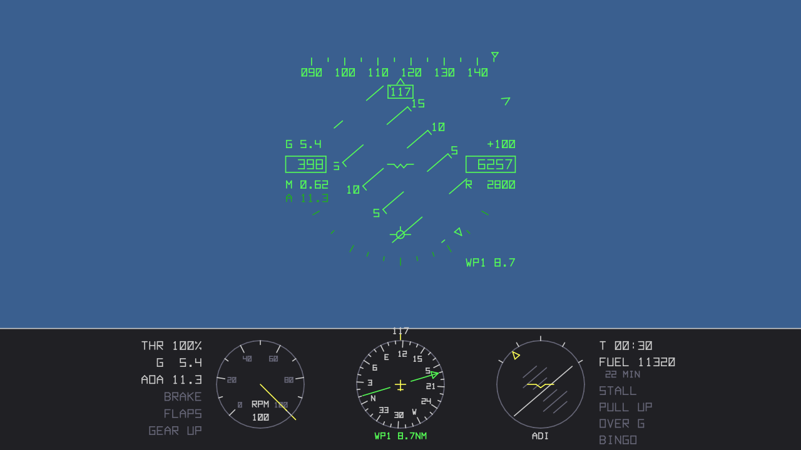
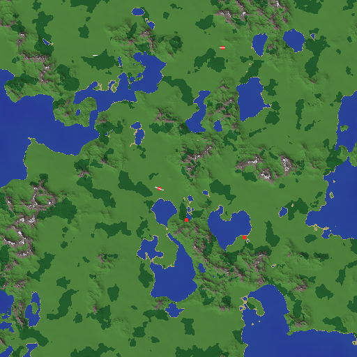

# F-29 Silent Sniper

Ein eigenständiger Stealth-Flugsimulator in Rust, inspiriert von *F-19 Stealth Fighter*
(MicroProse, 1988): Tarnkappen-Angriffsflüge bei Nacht, Radarlücken im Gelände und
Präzisionsangriffe, dazu eine Karriere mit Szenarien, Rängen und Orden. Alles wird neu
gebaut, mit eigener Physik, eigenen Werten und eigener Grafik im Retro-Stil, die in
jeder Auflösung scharf bleibt.

> **Clean Room:** Dieses Projekt enthält keinen Code, keine Daten und keine Assets des
> Originals. Mechaniken werden nach Verhaltensbeschreibung nachgebaut; das Vorgehen ist
> in [`docs/MECHANICS.md`](docs/MECHANICS.md) festgelegt und protokolliert.

**Status:** v0.1 abgeschlossen: Freiflug über prozeduralem Gelände mit HUD und zwei
MFDs, Start und Landung auf der Heimatbasis, Treibstoff, Klang.
v0.2 (Angriff und Tarnung) abgeschlossen bis auf den Joystick-Test: Bodenziele,
Zielerfassung, Bomben, Lenkwaffen und Kanone, feindliche Radare und Boden-Luft-Raketen,
Schadensmodell, Täuschkörper und Störer. Als Nächstes: v0.3 (Missionen).

[](https://github.com/peddn/f-29-silent-sniper/actions/workflows/ci.yml)

| HUD und MFDs (`f29-headless hud-svg`) | Prozedurales Gelände, 120 × 120 km (`f29-headless terrain`) |
|---|---|
|  |  |

## Schnellstart

Voraussetzung: aktuelles stabiles Rust (≥ 1.97).

```sh
# Spiel starten (beim ersten Mal dauert der Build einige Minuten): Titelbild,
# dann Menüs wie im Original – Auftrag, Briefing, Schlussauswahl mit „Select New
# Mission“; Pfeile wählen, Leertaste bestätigt. Eigene Grafik und Musik:
# crates/f29-app/assets/title.png (16:10, Pixelart) und assets/music/theme.ogg
cargo run --release -p f29-app

# ohne Menü gleich fliegen (auch mit --start oder --screenshot)
cargo run --release -p f29-app -- --fly

# anderer Seed = anderes Gelände, Start in der Verfolgeransicht
cargo run --release -p f29-app -- --seed 1234 --view chase

# Luftstart statt Start auf der Bahn
cargo run --release -p f29-app -- --start air

# Nachtflug: dunkle Darstellung, optische Erfassung nur noch 20 km
cargo run --release -p f29-app -- --night

# ohne freundliches AWACS: ferne Ziele fehlen auf der Karte
cargo run --release -p f29-app -- --no-awacs

# Testoption: Stealth-Level immer 0, jeder Radarping in Reichweite trifft
cargo run --release -p f29-app -- --no-stealth

# Testoption: Raketentreffer ohne Schaden (gemeldet, aber folgenlos)
cargo run --release -p f29-app -- --no-damage

# Lautstärke in Prozent (Standard 80) bzw. ganz ohne Ton
cargo run --release -p f29-app -- --volume 50
cargo run --release -p f29-app -- --no-sound

# andere Beladung der vier Schächte: fall, chute, lgb, agm, arm, ship, aim9, aim120,
# cam (Aufklärungskamera), tank (Zusatztank) oder -; ohne Angabe die vorgeschlagene
# Beladung des Auftrags (im Menü: „Arm Your Plane“; die Bilder der Ausrüstung dort
# sind SVG-Dateien in crates/f29-app/assets/stores/<code>.svg und lassen sich ersetzen)
cargo run --release -p f29-app -- --loadout fall,fall,agm,arm
# Regelset: Kalter Krieg (nur Aufklärung; Gegner feuern nur über feindlichem
# Gebiet; angreifen nur, was uns entdeckt hat), begrenzter Konflikt oder
# offener Krieg (Standard)
cargo run --release -p f29-app -- --rules cold
# Dienstplan aus einer anderen Datei (Standard: roster.ron im Datenordner des
# Benutzers, unter Linux ~/.local/share/f29-silent-sniper/)
cargo run --release -p f29-app -- --roster piloten.ron

# nach 10 s automatisch einen Screenshot speichern und beenden
cargo run --release -p f29-app -- --screenshot bild.png --after 10

# Tests (ohne Grafik, ohne Bevy – in Sekunden)
cargo test
```

Unter **Linux** braucht Bevy einige Systempakete, z. B. für Debian/Ubuntu:

```sh
sudo apt install libudev-dev libwayland-dev libxkbcommon-dev libasound2-dev pkg-config
```

## Steuerung

| Taste | Joystick (Extreme 3D Pro) | Funktion |
|---|---|---|
| ↑ / W, ↓ / S | Knüppel vor/zurück | drücken / ziehen |
| ← / A, → / D | Knüppel links/rechts | rollen; am Boden lenken (auch im Stand) |
| Q / E | Drehgriff | Seitenruder |
| `+` / `-` | Schubregler | Schub stufenlos (der Regler gilt, sobald er bewegt wird) |
| 1 … 9, 0, `^`/`` ` `` | | Schub 10 … 90 %, 100 %, Leerlauf |
| B | 9 | Luftbremse ein/aus; am Boden Radbremse |
| F | 8 | Klappen ein/aus – bei jeder Fahrt: langsam gut steuerbar, schnell weniger Fahrtverlust in Kurven |
| G | 7 | Fahrwerk aus/ein (am Boden gesperrt) |
| N | 6 | nächster Navigationspunkt |
| V | 5 | Radar ein/aus (schaltet ohne Sichtlinie auf; eingeschaltet etwas sichtbarer für feindliche Radare, wie ein offener Schacht) |
| O | 4 | Schachtklappen auf/zu |
| C | (frei belegbar: `chaff`) | Düppel abwerfen (gegen radargelenkte Raketen SA-6, SA-5) |
| T | (frei belegbar: `flare`) | Fackel abwerfen (gegen die infrarotgelenkte SA-13) |
| M | (frei belegbar: `ecm`) | Störsender (ECM) ein/aus: Radarraketen verlieren außerhalb von 2 km die Lenkung; sichtbarer wie ein offener Schacht |
| U | (frei belegbar: `ir_jammer`) | Infrarotstörer für 30 s, danach 60 s Abklingzeit: Infrarotraketen verlieren außerhalb von 2 km die Lenkung |
| Tab | 3 | nächste Waffe: GUN → BAY 1 → … → BAY 4 → GUN (Start: GUN) |
| Leertaste | 2 | gewählte Waffe auslösen (Schachtwaffen nur bei offenem Schacht; die Kanone feuert, solange die Taste gehalten wird) |
| Rücktaste (gehalten) | 1 (Abzug) | Bordkanone feuern, gleich welche Waffe gewählt ist (nicht am Boden) |
| H | 12 | HUD-Modus: NAV → AG (Luft-Boden) → AA (Luft-Luft) |
| I / L / K / J | Coolie-Hat | Blickrichtung der Zielerfassung: voraus / rechts / hinten / links – wählt im HUD-Modus AA Jäger, AG Bodenziele, NAV Landebahnen (automatisch das nächste entdeckte Ziel; dieselbe Richtung noch einmal = nächstweiteres; die Richtung folgt dem gewählten Ziel) |
| Shift+F1 / Shift+F2 | | Cockpit / Verfolger |
| Shift+F3 | | Retro-Look: voll → nur Palette → aus |
| Shift+F4 | | HUD ein/aus |
| Shift+F5 | | Weitwinkelsicht: ohne Instrumentenbrett, Ansicht übers ganze Fenster (Luftkampf) |
| F3 | | Karte (linkes MFD): Gitter ↔ Satellitenbild |
| F4 | 11 | Rechtes MFD: nächste Seite (Mission → Ziel → Waffenkamera → Waffen → Triebwerk → Horizont → Systeme) |
| Y / X | 10 (reihum) | Karte näher / weiter (0,6 bis 640 km, je Stufe doppelt; außerhalb des Gebiets schwarz) |
| P | | Pause |
| Strg+I / J / K / L | | Blick aus dem Cockpit: vorn / links / hinten / rechts (nur vorn mit HUD) |
| Strg+E | | Schleudersitz (bis 450 kt und 60° Quer-/Längsneigung; das Gebiet entscheidet: gerettet, Zwischenfall, gefangen) |
| Shift+T | | Zeitraffer 1× → 2× → 4× → 1×; endet bei Fahrwerk, Raketenstart, steigender Alarmstufe, Treffer |
| F12 | | Screenshot nach `screenshots/` |
| R | | Neustart (Flug wird als Replay gesichert) |
| Esc, Alt+Q | | Beenden (Flug wird als Replay gesichert; vor dem Dienstplan beendet, zählt der Einsatz nicht) |

### Joystick

Unterstützt wird ein Joystick mit vielen Tasten unter **Linux**; voreingestellt
ist der **Logitech Extreme 3D Pro** (Belegung oben). Die Belegung steht als
Text in [`config/joystick.cfg`](config/joystick.cfg). Eine eigene Fassung als
`joystick.cfg` im Startverzeichnis (oder `--joystick DATEI`) ersetzt sie;
nicht belegte Aktionen wie `view` oder `pause` lassen sich dort ergänzen.

```sh
cargo run --release -p f29-app -- --joystick-debug
```

meldet beim Anstecken den Namen des Sticks und danach jede Achse und Taste auf
der Konsole – in derselben Schreibweise wie die Datei (z. B. `Taste B3
gedrückt`, `Achse ABS 6 -0.84`). Falls Achsen falsch herum laufen, hilft
`invert` hinter der Achse. Liest das Spiel keinen Stick, fehlt meist das
Leserecht auf `/dev/input/event*` (Gruppe `input`).

## Klang

Die Klänge entstehen zur Laufzeit per Synthese im Retro-Stil. Nur die beiden
Ansagen für „PULL UP“ und „OVER G“ sind Samples: `crates/f29-audio/sounds/*.wav`
(PCM, eingebettet). Vorerst CC0-Platzhalter aus Kenneys Voiceover Pack
(„Look out!“, „Hold!“), Herkunft in `crates/f29-audio/sounds/README.md`. Wer sie
ersetzen will, legt dort eine andere PCM-WAV-Datei ab (8/16 Bit, beliebige
Abtastrate; nur frei lizenzierte Aufnahmen, keine aus anderen Spielen).
Hörproben ohne Spiel: `cargo run -p f29-headless -- sound --out sounds`.

## Werkzeuge ohne Grafik

```sh
cargo run --release -p f29-headless -- demo --seconds 300 --record flug.replay
cargo run --release -p f29-headless -- replay flug.replay        # Hash-Prüfung
cargo run --release -p f29-headless -- replay replays/last.replay # letzter Flug aus dem Spiel
cargo run --release -p f29-headless -- hud-svg --seconds 30 --out hud.svg
cargo run --release -p f29-headless -- terrain --seed 7 --out karte.ppm
cargo run --release -p f29-headless -- airfields --seed 7          # Flugplätze und Route
cargo run --release -p f29-headless -- sound --out sounds          # Klänge als WAV-Hörproben
cargo run --release -p f29-headless -- bench
```

## Aufbau

```
crates/
  f29-data/      Spieldaten (Flugzeugparameter)
  f29-world/   Einsatzgebiete (Daten) und deterministisches Gelände
  f29-core/      Simulationskern: Flugmodell, fester Tick, Replays – keine Engine
  f29-hud/       HUD und Instrumente als Vektor-Display-Liste
  f29-render/    engine-neutrale Geometrie: Terrain-Meshes, Modell, Palette
  f29-audio/     prozedurale Klangsynthese und Sprachansagen – keine Engine
  f29-headless/  Kommandozeile: Demo, Replays, HUD-SVG, Höhenkarte, WAV-Hörproben
  f29-app/       Spiel (Bevy): Fenster, Eingabe, Kameras, Streaming, Retro-Shader
docs/
  ARCHITECTURE.md  Aufbau, Koordinatensysteme, Determinismus, Teststrategie
  MECHANICS.md     Clean-Room-Protokoll und Mechanik-Einträge
```

Nur `f29-app` hängt von Bevy ab. Simulation, Gelände, HUD und Geometrie sind ohne
Grafikkarte testbar. Die Simulation ist **bitgenau deterministisch**: Ein
Golden-Replay-Test prüft in der CI auf Linux, Windows und macOS denselben Zustands-Hash.
Details in [`docs/ARCHITECTURE.md`](docs/ARCHITECTURE.md).

## Roadmap

### v0.1: Freiflug ✈️ *(abgeschlossen)*
- [x] Deterministischer Simulationskern, 120 Hz, Replays mit Hash-Prüfung
- [x] Flugmodell: Kräftebilanz + Fly-by-Wire (g-Begrenzer), ISA-Atmosphäre
- [x] Strömungsabriss mit Durchsacken, Fahrtverlust in Kurven, begrenzte Steigleistung
- [x] Prozedurales Gelände (Meer, Küsten, Gebirge, Wald) mit Kollision
- [x] HUD: Pitch-Ladder, Flight Path Marker, Kursband, Fahrt/Höhe, Querlage, Warnungen
- [x] Instrumente: Triebwerk, HSI mit Navigationspunkt, künstlicher Horizont
- [x] Navigationsroute mit Steerpoint-Anzeige in HUD und HSI
- [x] Retro-Look: 16-Farben-Palette, Dithering, auflösungsunabhängig
- [x] Cockpit- und Verfolgeransicht, Tastatur und Gamepad (Gamepad in v0.2.8 durch Joystick ersetzt)
- [x] Erster Spieltest auf echter Hardware (Linux, AMD Radeon, Vulkan)
- [x] Feinschliff Flugverhalten nach erstem Spielerfeedback (v0.1.1)
- [x] Radarhöhe über Grund immer im HUD
- [x] Turbulenz unter 1000 ft über Grund, Landeklappen, stärkere Schubwirkung (v0.1.4/0.1.5)
- [x] Treibstoff als Masse, quadratischer Verbrauch, Flameout, FUEL LOW / BINGO (v0.1.6)
- [x] Heimatbasis und geheime Pisten, Fahrwerk, Rollen und Wenden am Boden,
      Aufsetzbewertung, PAPI und Landehilfen im HUD, Start auf der Bahn (v0.1.6)
- [x] Instrumentenbrett mit zwei MFDs: Karte (Gitter/Satellit, Flugrichtung oben,
      zoombar) und Ressourcen (Treibstoff, Waffenstationen); Platz für die
      Stealth-/Radarimpuls-Anzeige (v0.1.10); Schubhebel, Konfiguration im HUD (v0.1.11)
- [x] Klang: prozedurale Retro-Synthese (Triebwerk, Fahrwerk, Klappen, Luftbremse,
      Aufsetzen, Absturz), gesprochene Abrisswarnung (v0.1.12); Abriss-Alarmton,
      PULL-UP-Ansage mit Platz für ein eigenes Sample (v0.1.14)
- [x] Feste Zeilen für GEAR, FLAPS und AIRBRAKE im HUD
- [x] Flugmodell nach Spieltests: Durchsacken im Langsamflug (v0.1.15), gefährlicher
      Abriss mit großem Höhenverlust (v0.1.16), vereinfachtes Abrissmodell und
      Kennwert-Tests mit `flight_report` (v0.1.17), mehr Schub, späterer
      Kurvenabriss, Klappen nicht mehr immun gegen Abriss (v0.1.18)
- [x] MFD-Seiten: Mission (Route, Heimweg, Ziele als Platzhalter), Waffen (vier
      Schächte, Platzhalter), Triebwerk mit Treibstoff, Reserve-Horizont,
      Systeme (v0.1.19)

### v0.2: Angriff und Tarnung *(abgeschlossen)*
- [x] Bodenziele in neun eigenen Klassen, alle auf der Karte, Primär- und
      Sekundärziel; Zielerfassung optisch (mit Sichtlinie) und per Radar
      (abschaltbar, durch Berge), automatisch auf das nächste Ziel der
      Blickrichtung; HUD-Zielrahmen und MFD-Seite mit optischem Zielbild (v0.2.1)
- [x] Ziele einer Richtung durchschalten; Zielbild als gezoomte, verrauschte
      Kamera (v0.2.2); Aufschaltung bleibt beim Überflug, Blickrichtung folgt (v0.2.3)
- [x] Waffenschacht mit Klappen, Standardbeladung (`--loadout`), Bomben mit echter
      Ballistik (Freifall, Fallschirm), Wirkungsmatrix Waffe × Zielklasse mit
      Abstandsabfall, gehärtete Ziele nur bei steilem Eintreffen, Wracks,
      Splitterwarnung, WPN-Seite mit Bestand, Meldungen (v0.2.4)
- [x] Bordsysteme als Gerüst für das Schadensmodell: acht Systeme mit Zustand
      und Wirkung, Übersicht auf der SYS-Seite (v0.2.4)
- [x] Lenkwaffen mit eigenem Suchkopf (Fire and Forget): Gleitbombe,
      Luft-Boden-Rakete, Radarjäger, Seezielrakete; gewürfelter Endanflug nach
      Startgüte (Miss, Near Miss, Hit, 1 % kritisch), Schaden pro Treffer sammelt
      sich am Ziel, Zielrahmen zeigt Reichweite und Sweet Spot (v0.2.5)
- [x] Waffen mit realen Bezeichnungen (Mk 82, Mk 82 Snakeye, GBU-12 Paveway II,
      AGM-65 Maverick, AGM-88 HARM, AGM-84 Harpoon); Aufschaltung bleibt auf dem
      Wrack, zerstörte Ziele verschwinden von der Karte; gewählte Waffe unten
      links im HUD; Maverick nur mit optischer Aufschaltung, ohne Aufschaltung
      geradeaus in Abschusslage (v0.2.5)
- [x] Zielhilfe für Bomben im HUD: Aufschlagpunkt mit Fall-Linie, Warnung
      „TOO LOW“ (v0.2.6)
- [x] Lenkwaffen vereinfacht: Abschusskreis ±8° für Raketen, Startgüte nur aus
      der Entfernung (Maverick 16 km, Sweet Spot 8 km), Flug zeigt den Wurf;
      lasergelenkte GBU-12 mit Gleitkorridor und Beleuchtung bis zum Einschlag
      (v0.2.7)
- [x] Sensoren 50 km (nachts optisch 20 km), Nachtflug, AWACS-Datalink für
      Ziele außerhalb der eigenen Erfassung, Feuersignal „IN RANGE“/„SHOOT“,
      HUD-Warnfarbe blau (v0.2.7)
- [x] HUD überarbeitet: breiteres Glas, drei Modi NAV/AG/AA (Taste H), Kanone als
      erste Waffe in der Wahl GUN, BAY 1–4 (v0.2.8)
- [x] Joystick statt Gamepad: Logitech Extreme 3D Pro unter Linux, Belegung als
      Textdatei, `--joystick-debug` (v0.2.8)
- ~~Auslöseklammer für Bomben~~ (gestrichen, Spielerentscheidung v0.2.9: Aufschlagpunkt
      und Fall-Linie genügen)
- [x] Bordkanone als eigenes Waffensystem: 600 Schuss (50/s), Rücktaste, 2 %
      Schaden pro Treffer bei jedem Ziel, Kanonenkreuz am Aufschlagpunkt,
      Leuchtspur (v0.2.8)
- [x] Entdeckungsmodell: SAM-Stellungen (Doppler) und Frühwarnradare (Impuls)
      pingen je Antennenumlauf; Impuls gegen Stealth-Level (wie im Original
      ein Wert: Höhe über Grund, Querlage, Schacht, eigenes Radar – tief und
      waagerecht fliegen); Alarmstufen 1–3 mit
      Abklingen, gemerkter Ping-Ort; SIG-Anzeige, Pieps, Reichweitenkreise
      (v0.2.9)
- [x] Lenkwaffen physikalisch wie im Original: reine Verfolgung, Treffer
      geometrisch (Annäherungszünder), Wirkung gewürfelt; „SHOOT“ aus dem
      vorausberechneten Flug statt Sweet Spot (v0.2.9)
- [x] Karte aufgeräumt: Höhenbild in Graustufen statt Höhenlinien, größere
      und einfachere Zielsymbole (v0.2.9)
- [x] Feuersignal „LOCKED“/„SHOOT“; Waffenkamera der Maverick auf der Seite
      WPN CAM, nach dem Abschuss automatisch aufgeschaltet (v0.2.9)
- [x] Boden-Luft-Raketen ab „RADAR ID“: SA-6 der SAM-Stellungen, SA-5 der
      Frühwarnradare; halbaktiv (weit weg nur, solange die Stellung uns
      erfasst), Treffer beschädigen zwei Bordsysteme; Raketenwarnung mit Ton,
      Rauchspur (v0.2.9)
- [x] Drei SAM-Typen mit Startprofil: SA-8 (Kurzstrecken-Flugabwehr bei den
      Zielen, direkt), SA-6 (Boost und Bogen), SA-5 (fast senkrechter Start,
      ausgeprägter Bogen); Vorhalt für alle Lenkwaffen (v0.2.9)
- [x] Täuschkörper: Düppel (C) gegen Radar-, Fackeln (T) gegen Infrarotlenkung,
      je 20; Kurzstrecken-SAM als SA-13 mit Infrarotsuchkopf (gemeinsamer
      optischer Suchkopf mit der Maverick); Ziele der Lenkwaffen als
      Bodenziel/Flugzeug/Täuschkörper (v0.2.9)
- [x] Störer: ECM (M, ein/aus, sichtbarer) und Infrarotstörer (U, 30 s);
      stärkere SAMs, Start schon mit „RADAR ID“ (v0.2.9)
- [x] SAMs nach Spieltest: Gefährlichkeit über Fahrt, Suchkegel und Resistenz
      gegen Täuschkörper – Querflug schüttelt die meisten ab, die neue moderne
      SA-11 (jede dritte SAM-Stellung) kaum; Täuschkörper ohne Obergrenze in der
      Luft, nur gegen Raketen gegen die eigene Seite; Prüfstand `sam_report`;
      Karte färbt feindliche Raketen nach Lenkart (v0.2.9)
- ~~Flak~~ (gestrichen, Spielerentscheidung v0.2.9)

### v0.3: Missionen
- [x] Regelsets Kalter Krieg / Begrenzter Konflikt / Offener Krieg
      (`--rules`): wo und wie viel der Gegner feuert, Entdeckungskosten für
      die Wertung; MSN-Seite mit Regelset und Gebiet (v0.3)
- [x] Einsatzgebiete als Daten (M-031, Crate `f29-world`): Gebiet
      „NORTH COAST“, 500 km, Grobraster 64 × 64 (Gelände, Seite) formt das
      Gelände; Flugplätze und alle Ziele aus der Datei; `f29-headless
      theater-new` / `theater-png`; Kartenbild über das ganze Gebiet (v0.3)
- [x] Missionsgenerator: zwei Ziele aus dem Gebiet, das nähere ist das
      Primärziel; Route Start → Primär → Sekundär → Landung; geheime Pisten
      entfallen (v0.3)
- [x] Missionsauftrag (M-032): je Ziel Angriff oder Aufklärung, Mischung nach
      Regelset; Aufklärungskamera (Foto bis 1,5 km, 5° um ihre geneigte
      Sichtlinie, Bildkreis im HUD, Kamerabild auf der TGT-Seite); vorgeschlagene Beladung; Aufklärung bei
      Tag; Kalter Krieg: Angriff nur auf Ziele, die uns entdeckt haben, sonst
      ROE VIOLATION (v0.3)
- [x] Flugprotokoll und Missionsende: Landung beendet die Mission,
      Schleudersitz (Strg+E), Gebiet entscheidet über Rettung,
      Zwischenfall oder Gefangenschaft; Ergebnistafel (v0.3)
- [x] Planquadrate in Lagebesprechung (Text und Karte) und auf der MSN-Seite
- [x] Geländeart als Radarfaktor: Hügel und Gebirge verkürzen im Tiefflug die
      Reichweite feindlicher Radare
- [x] Missionsdaten in der Lagebesprechung: Karte mit Zielen, Route, Radarkreisen
      und Fliegerhorsten, Texte je Thema
- [x] Bewaffnung und Betankung vor dem Start (Zusatztanks), Missionsauswertung
- [x] Verbrauchsvorschau: Strecke und Verbrauch je Abschnitt und Rest auf
      der MSN-Seite (jetziger Verbrauch samt Leck) und in der Lagebesprechung
      (Planung)
- [ ] Flugzeugträger

### v0.4: Luftkampf
- [x] Etappe 1a: zwei feindliche Fliegerhorste, je fünf Jäger (MiG-21, MiG-29),
      Start bei Alarm, Abfangen, Patrouille, Verfolgen mit eigenem Radar,
      Rückflug und Landung; Karte (v0.2.9)
- [x] Etappe 1b: Jäger in 3D, Radar-Aufschaltung auf Luftziele, Zielrahmen im
      AA-Modus (v0.2.9)
- [x] HUD-Modus als Zielfilter (HUD seit v0.3 nur das gewählte Ziel, die Karte alle),
      I/J/K/L wählen je Modus Jäger (AA), Bodenziele (AG) oder Landebahnen mit
      FRIENDLY/HOSTILE (NAV); ein Erfassungskreis je Modus (AA ±10°, AG ±6°);
      Jäger als Punkt bis 15 km sichtbar; `--no-damage` (v0.2.9)
- [x] Zielsystem vereinheitlicht: vier Stufen gemeldet (AWACS, gestrichelt) /
      entdeckt (Radar oder optisch, rundum, für alle Zielarten gleich; R/O) /
      gewählt (doppelt) / erfasst (Ecken), in HUD und Karte aus einer Liste;
      eine Auswahl je Zielart (v0.2.9)
- [x] Etappe 2: Jäger abschießbar (Kanone 5 bzw. 8 Treffer, Rakete
      zerstört), Kanone gegen Luftziele mit Vorhaltemarke, AIM-9 Sidewinder
      (`aim9`, 4 je Schacht, optisch), AIM-120 AMRAAM (`aim120`, 3 je Schacht,
      eigenes Radar), Fackeln und Düppel der Jäger (v0.2.9)
- [x] Etappe 3: Jäger feuern AA-8 (MiG-21) bzw. AA-10 (MiG-29, halbaktiv)
      und schießen mit der Kanone (Treffer kosten Schub, mit 15 % ein
      System); sie weichen Raketen querab bzw. mit Abschwung aus (v0.2.9)
- [x] Weitwinkelsicht ohne Instrumentenbrett für den Luftkampf (Shift+F5,
      v0.2.9)
- ~~Radarwarnempfänger~~ (gestrichen, Spielerentscheidung v0.2.9)

### v0.5: Karriere
- [x] Pilot mit Laufbahn: Punkte, sieben Ränge, Orden und Bänder (Namen wie
      im Original, eigene Schwellen), Ruhestand nach 60 Einsätzen; Ehrung
      nach der Nachbesprechung (vorerst Text)
- [ ] Mehrere eigene, fiktive Einsatzgebiete (Szenarien)
- [x] Konfliktstufen von „Spannung“ bis „offener Krieg“ mit unterschiedlichen
      Einsatzregeln (COLD WAR, LIMITED, OPEN WAR, M-033)
- [x] Verlauf: Abschuss, Gefangennahme (verzögert die Beförderung), Rettung,
      Ruhestand; Spielstände im Dienstplan

### v0.6: Präsentation
- [x] Titelbild (Mockup), Menüs, Lagebesprechung mit Karte, Nachbesprechung –
      bevy_ui in der Pixelschrift Departure Mono
- [x] Klang: Waffen, Radarwarnung; Musik (Wiedergabe)
- [ ] Titelgrafik und Musikdatei (`assets/title.png`, `assets/music/theme.ogg`)
- [ ] Grafiken der Ehrung: Rangabzeichen, Orden und Bänder (liefert der
      Spieler nach; bis dahin nur Text)
- [x] Dienstplan mit Pilotenakten (zehn Plätze, Punkte und Einsätze, Datei
      im Datenordner des Benutzers)
- [ ] Flugzeugerkennung
- [ ] Einstellungen, frei belegbare Tasten, Joystick/HOTAS
- [ ] Joystick am echten Extreme 3D Pro testen (`--joystick-debug`): Achsen,
      Richtungen und Tastennummern prüfen

### v1.0: Vollständige Karriere
- [ ] Karrieremodus mit mindestens vier Einsatzgebieten, kompletter Ordensliste und
      Ruhmeshalle
- [ ] Balancing über alle Schwierigkeitsgrade

## Lizenz

Wahlweise [MIT](LICENSE-MIT) oder [Apache 2.0](LICENSE-APACHE).

Die Pixelschrift Departure Mono unter `crates/f29-app/assets/fonts/` steht
unter der SIL Open Font License 1.1 (`departure-mono.LICENSE` daneben).

*F-19 Stealth Fighter* ist eine Marke ihrer jeweiligen Rechteinhaber. Dieses Projekt
ist ein unabhängiges Fanprojekt und steht in keiner Verbindung zu MicroProse oder
dessen Rechtsnachfolgern.
