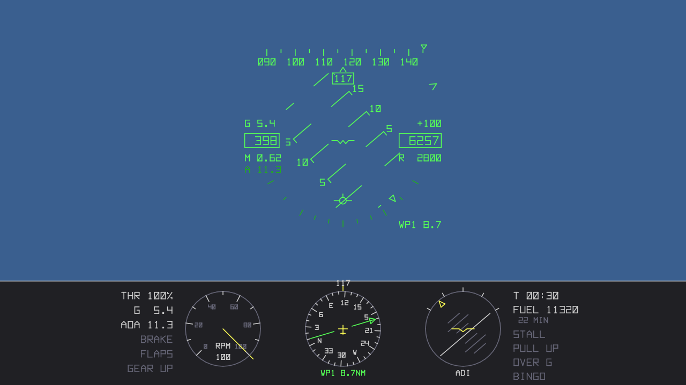
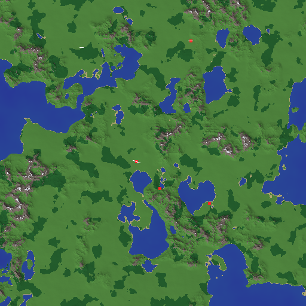

# F-29 Silent Sniper

Ein eigenständiger Stealth-Flugsimulator in Rust, inspiriert von *F-19 Stealth Fighter*
(MicroProse, 1988): Tarnkappen-Angriffsflüge bei Nacht, Radarlücken im Gelände und
Präzisionsangriffe, dazu eine Karriere mit Szenarien, Rängen und Orden. Alles wird neu
gebaut, mit eigener Physik, eigenen Werten und eigener Grafik im Retro-Stil, die in
jeder Auflösung scharf bleibt.

> **Clean Room:** Dieses Projekt enthält keinen Code, keine Daten und keine Assets des
> Originals. Mechaniken werden nach Verhaltensbeschreibung nachgebaut; das Vorgehen ist
> in [`docs/MECHANICS.md`](docs/MECHANICS.md) festgelegt und protokolliert.

**Status:** v0.1 in Arbeit: Freiflug über prozeduralem Gelände mit HUD.

[](https://github.com/peddn/f-29-silent-sniper/actions/workflows/ci.yml)

| HUD und Instrumente (`f29-headless hud-svg`) | Prozedurales Gelände, 120 × 120 km (`f29-headless terrain`) |
|---|---|
|  |  |

## Schnellstart

Voraussetzung: aktuelles stabiles Rust (≥ 1.97).

```sh
# Spiel starten (beim ersten Mal dauert der Build einige Minuten)
cargo run --release -p f29-app

# anderer Seed = anderes Gelände, Start in der Verfolgeransicht
cargo run --release -p f29-app -- --seed 1234 --view chase

# nach 10 s automatisch einen Screenshot speichern und beenden
cargo run --release -p f29-app -- --screenshot bild.png --after 10

# Tests (ohne Grafik, ohne Bevy – in Sekunden)
cargo test
```

Unter **Linux** braucht Bevy einige Systempakete, z. B. für Debian/Ubuntu:

```sh
sudo apt install libudev-dev libwayland-dev libxkbcommon-dev pkg-config
```

## Steuerung

| Taste | Gamepad | Funktion |
|---|---|---|
| ↑ / W, ↓ / S | linker Stick vor/zurück | drücken / ziehen |
| ← / A, → / D | linker Stick links/rechts | rollen |
| Q / E | Trigger links/rechts | Seitenruder |
| `+` / `-` | rechter Stick vor/zurück | Schub stufenlos |
| 1 … 9, 0, `^`/`` ` `` | | Schub 10 … 90 %, 100 %, Leerlauf |
| B | B / Kreis | Luftbremse ein/aus |
| N | A / Kreuz | nächster Navigationspunkt |
| F1 / F2 / V | Select | Cockpit / Verfolger / umschalten |
| H | | HUD ein/aus |
| F3 | | Retro-Look: voll → nur Palette → aus |
| P | Start | Pause |
| F12 | | Screenshot nach `screenshots/` |
| R | | Neustart (Flug wird als Replay gesichert) |
| Esc | | Beenden (Flug wird als Replay gesichert) |

## Werkzeuge ohne Grafik

```sh
cargo run --release -p f29-headless -- demo --seconds 300 --record flug.replay
cargo run --release -p f29-headless -- replay flug.replay        # Hash-Prüfung
cargo run --release -p f29-headless -- replay replays/last.replay # letzter Flug aus dem Spiel
cargo run --release -p f29-headless -- hud-svg --seconds 30 --out hud.svg
cargo run --release -p f29-headless -- terrain --seed 7 --out karte.ppm
cargo run --release -p f29-headless -- bench
```

## Aufbau

```
crates/
  f29-data/      Spieldaten (Flugzeugparameter)
  f29-terrain/   deterministisches prozedurales Gelände
  f29-core/      Simulationskern: Flugmodell, fester Tick, Replays – keine Engine
  f29-hud/       HUD und Instrumente als Vektor-Display-Liste
  f29-render/    engine-neutrale Geometrie: Terrain-Meshes, Modell, Palette
  f29-headless/  Kommandozeile: Demo, Replays, HUD-SVG, Höhenkarte
  f29-app/       Spiel (Bevy): Fenster, Eingabe, Kameras, Streaming, Retro-Shader
docs/
  ARCHITECTURE.md  Aufbau, Koordinatensysteme, Determinismus, Teststrategie
  MECHANICS.md     Clean-Room-Protokoll und Mechanik-Einträge
```

Nur `f29-app` hängt von Bevy ab. Simulation, Gelände, HUD und Geometrie sind ohne
Grafikkarte testbar. Die Simulation ist **bitgenau deterministisch**: Ein
Golden-Replay-Test prüft in der CI auf Linux, Windows und macOS denselben Zustands-Hash.
Details in [`docs/ARCHITECTURE.md`](docs/ARCHITECTURE.md).

## Roadmap

### v0.1: Freiflug ✈️ *(aktuell)*
- [x] Deterministischer Simulationskern, 120 Hz, Replays mit Hash-Prüfung
- [x] Flugmodell: Kräftebilanz + Fly-by-Wire (g-/Alpha-Begrenzer), ISA-Atmosphäre
- [x] Prozedurales Gelände (Meer, Küsten, Gebirge, Wald) mit Kollision
- [x] HUD: Pitch-Ladder, Flight Path Marker, Kursband, Fahrt/Höhe, Querlage, Warnungen
- [x] Instrumente: Triebwerk, HSI mit Navigationspunkt, künstlicher Horizont
- [x] Navigationsroute mit Steerpoint-Anzeige in HUD und HSI
- [x] Retro-Look: 16-Farben-Palette, Dithering, auflösungsunabhängig
- [x] Cockpit- und Verfolgeransicht, Tastatur und Gamepad
- [ ] Erster Spieltest auf echter Hardware, Feinschliff Flugverhalten

### v0.2: Angriff und Tarnung
- [ ] Waffenschacht, Bomben mit echter Ballistik, CCIP/CCRP-Zielhilfe im HUD
- [ ] Wirkungsmatrix Waffe × Zielklasse, Wirkradius, gehärtete Ziele + Toss-Bombing
- [ ] Bodenziele und Boden-Luft-Bedrohungen (Radar-SAM, Flak)
- [ ] Radar-/Detektionsmodell: aspektabhängiger Radarquerschnitt, Geländemaskierung,
      Emissionen; Signaturanzeige im Cockpit
- [ ] Täuschkörper (Düppel, Fackeln)

### v0.3: Missionen
- [ ] Missionsdaten: Primär- und Sekundärziel, Route, Bedrohungslage
- [ ] Start und Landung (Flugplatz, Fahrwerk, Bodenrollen), Treibstoff
- [ ] Bewaffnung vor dem Start, Missionsauswertung

### v0.4: Luftkampf
- [ ] Luft-Luft-Raketen und Bordkanone
- [ ] Feindliche Jäger und Abfangjäger mit KI (aufbauend auf dem Autopiloten)
- [ ] Radarwarnempfänger

### v0.5: Karriere
- [ ] Pilot mit Laufbahn: Missionsfolge, Punkte, Ränge, Orden (eigene Namen)
- [ ] Mehrere eigene, fiktive Einsatzgebiete (Szenarien)
- [ ] Konfliktstufen von „Spannung“ bis „offener Krieg“ mit unterschiedlichen
      Einsatzregeln
- [ ] Verlauf: Abschuss, Gefangennahme, Rettung, Ruhestand; Spielstände

### v0.6: Präsentation
- [ ] Menüs, Briefing- und Debriefing-Bildschirme, Karte
- [ ] Klang: Triebwerk, Warnungen, Waffen
- [ ] Einstellungen, frei belegbare Tasten, Joystick/HOTAS

### v1.0: Vollständige Karriere
- [ ] Karrieremodus mit mindestens vier Einsatzgebieten, kompletter Ordensliste und
      Ruhmeshalle
- [ ] Balancing über alle Schwierigkeitsgrade

## Lizenz

Wahlweise [MIT](LICENSE-MIT) oder [Apache 2.0](LICENSE-APACHE).

*F-19 Stealth Fighter* ist eine Marke ihrer jeweiligen Rechteinhaber. Dieses Projekt
ist ein unabhängiges Fanprojekt und steht in keiner Verbindung zu MicroProse oder
dessen Rechtsnachfolgern.
